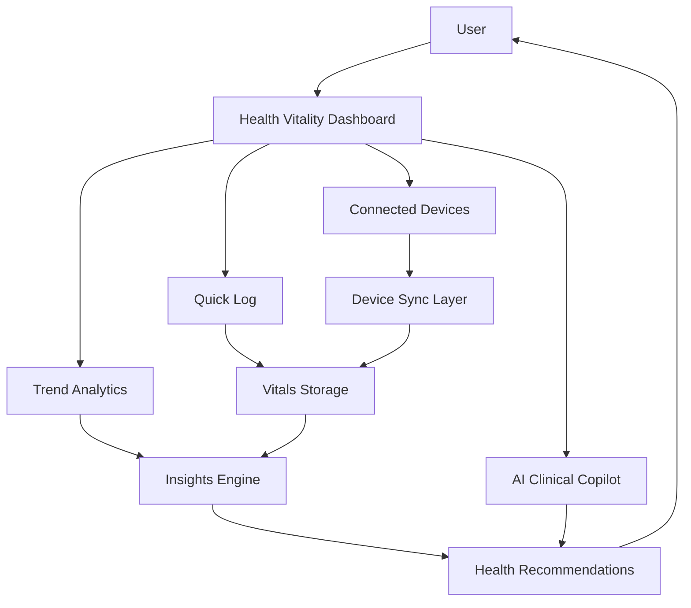
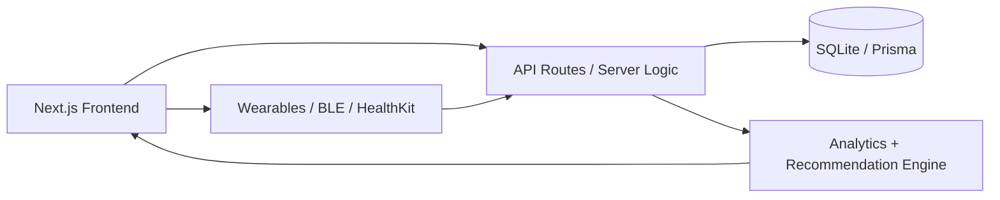
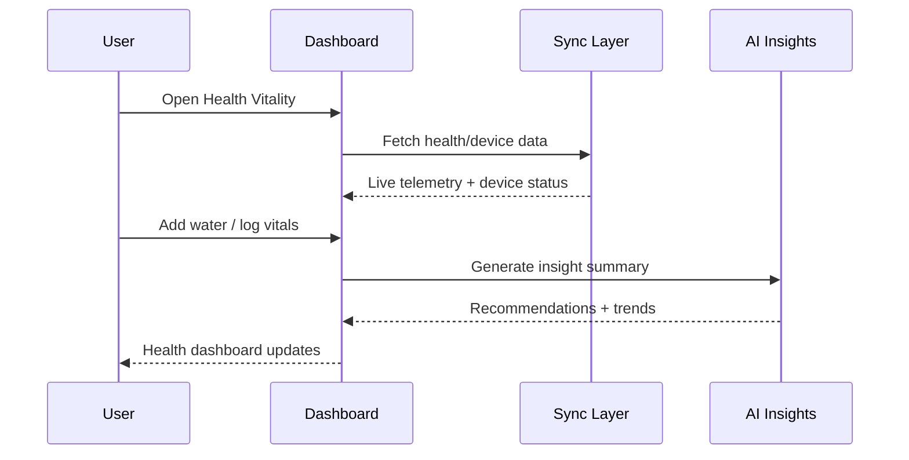
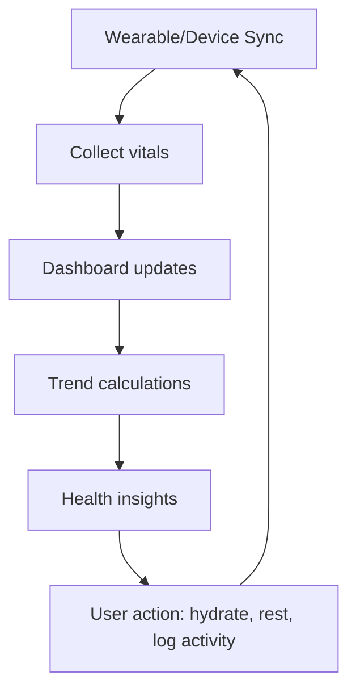

# Health Vitality

Health Vitality is your all-in-one health companion that unifies activity, nutrition, sleep, and vital signs into a single secure dashboard. Powered by smart insights and seamless wearable integration, it helps you build better habits, track your progress, and take control of your well-being.

## Overview

This project is a modern health analytics dashboard built with Next.js and TypeScript. It provides a live telemetry cockpit for monitoring key health indicators including heart rate, blood pressure, glucose, sleep quality, hydration, calories, and steps.

The platform is designed around:

- Real-time biometric monitoring
- Connected wearable/device synchronization
- AI-assisted insights and clinical summaries
- Privacy-first, secure health data handling
- Actionable trends and recovery analytics

## Key Features

- Live vitals dashboard with heart rate, SpO2, glucose, and recovery insights
- Weekly and monthly trend analytics
- Quick logging for manual health events
- Device sync simulation for Apple HealthKit, BLE, and wearable integrations
- AI clinical copilot experience for health questions and summaries
- Security vault and compliance-focused health data handling
- Responsive, modern UI tailored for health monitoring

## System Flow



## App Architecture



## User Journey



## Product Pillars

### 1. Real-Time Health Monitoring
Track the most important signals in one view, including:

- Heart rate and resting heart rate
- Blood pressure trends
- Blood glucose context
- Sleep quality and recovery score
- Water intake and activity metrics

### 2. Smarter Health Decisions
The app surfaces actionable insights using patterns and simple trend comparisons so users can understand the relationship between sleep, recovery, hydration, and daily energy.

### 3. Privacy and Trust
The design reflects a zero-trust, compliance-aware mindset, with emphasis on secure handling and audit-friendly behavior for sensitive health data.

## Tech Stack

- Next.js
- React
- TypeScript
- Tailwind CSS
- Prisma
- SQLite
- Framer Motion
- Lucide React

## Project Structure

```bash
health-vitality/
├── src/
│   ├── app/
│   │   ├── api/
│   │   ├── globals.css
│   │   └── page.tsx
│   ├── components/
│   ├── lib/
│   └── types/
├── prisma/
├── public/
├── package.json
├── next.config.ts
├── tsconfig.json
├── eslint.config.mjs
├── PRODUCT_SPECIFICATION.md
├── Health&Vitality.json
├── README.md
└── .gitignore
```

## Getting Started

### Prerequisites

Make sure you have the following installed:

- Node.js 18+
- npm, pnpm, yarn, or bun

### Install dependencies

```bash
npm install
```

### Run the development server

```bash
npm run dev
```

Then open http://localhost:3000 in your browser.

### Build for production

```bash
npm run build
```

### Start production server

```bash
npm run start
```

## Example Workflow



## Why This Project Matters

Health Vitality brings wellness data together in a single place so users can move from fragmented tracking to meaningful, moment-to-moment understanding of their health. The repository is positioned as a digital health platform prototype that blends monitoring, analytics, and artificial assistance into a seamless experience.

## License

This project is private and intended for personal or prototype use unless otherwise specified.

## Future Expansion Ideas

- Real backend persistence for user profiles and historical logs
- OAuth + authentication for secure personal accounts
- Integration with health APIs and wearable providers
- More advanced predictive health recommendations
- Advanced clinical report generation and export options

---

Built with care for better daily health awareness and long-term wellness.
