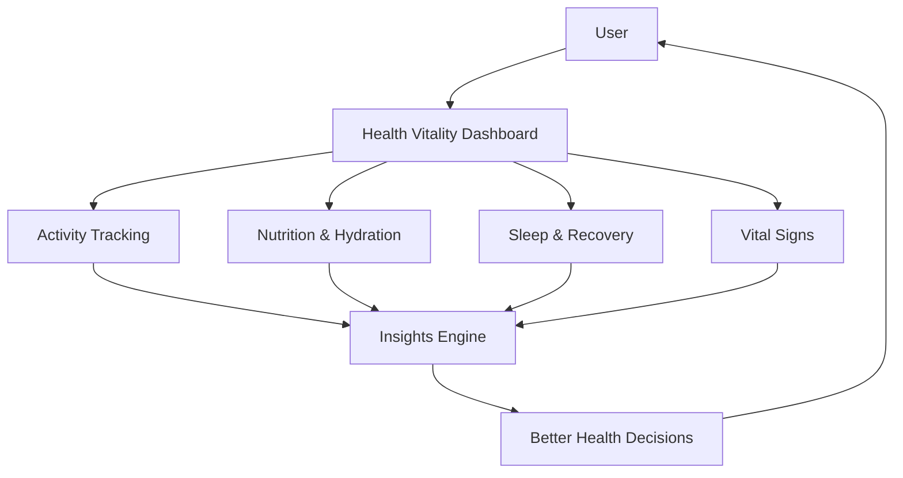
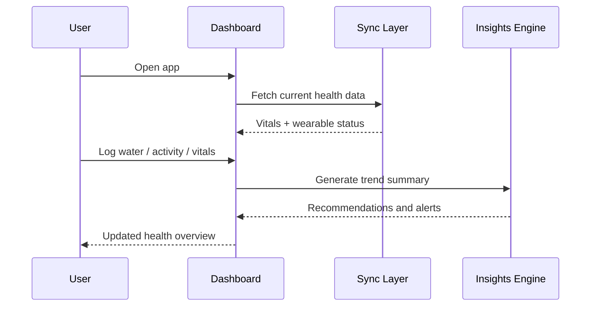
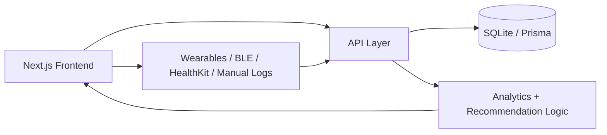

# Health Vitality

<div align="center">

  
  
  
  

</div>

Health Vitality is a modern health companion platform that brings daily activity, nutrition, sleep, hydration, and vital signs into one secure dashboard. It helps users understand how their habits affect recovery, performance, and long-term wellbeing.

## Why this project exists

Most people track health across multiple tools: fitness apps, sleep trackers, nutrition logs, and wearable dashboards. Health Vitality aims to unify that experience into one intelligent view so users can spot patterns faster and take better action.

## Core value

- Single view of health data
- Real-time monitoring and recovery insights
- Clear trends across daily, weekly, and monthly periods
- Device sync readiness for wearables and health ecosystems
- Privacy-aware, secure handling of sensitive health information

## Product snapshot



## Key features

- Live vitals dashboard with heart rate, blood pressure, SpO2, glucose, and recovery metrics
- Daily hydration and calorie tracking
- Sleep quality and rest trends
- Step and activity progress monitoring
- Quick manual logging for health inputs
- Connected device sync experience for wearables and BLE ecosystems
- AI-style clinical copilot experience for wellness summaries and recommendations
- Secure, compliance-aware dashboard presentation

## Experience flow



## Architecture overview



## Tech stack

- Next.js
- React
- TypeScript
- Tailwind CSS
- Prisma
- SQLite
- Framer Motion
- Lucide React

## Repository structure

```bash
health-vitality/
├── src/
│   ├── app/
│   │   ├── api/
│   │   ├── globals.css
│   │   └── page.tsx
│   ├── components/
│   ├── lib/
│   └── types/
├── prisma/
├── public/
├── package.json
├── next.config.ts
├── tsconfig.json
├── eslint.config.mjs
├── PRODUCT_SPECIFICATION.md
├── Health&Vitality.json
├── README.md
├── .gitignore
└── package-lock.json
```

## Getting started

### Prerequisites

- Node.js 18+
- npm, pnpm, yarn, or bun

### Install dependencies

```bash
npm install
```

### Run the app locally

```bash
npm run dev
```

Then open: http://localhost:3000

### Production build

```bash
npm run build
```

### Start production server

```bash
npm run start
```

## Usage examples

### Quick logging

Users can add hydration, health events, or metrics directly from the dashboard without leaving the main experience.

### Device sync workflow

The app is designed to support a wearable/device layer that can feed live telemetry into the app and surface connected-device status.

### Trend insights

The platform highlights recovery, activity, and vital trends to help users understand changes in their health over time.

## Product pillars

### 1. Unified health overview
A single, clean experience that combines multiple wellbeing streams without fragmentation.

### 2. Actionable intelligence
The app converts raw numbers into useful insight and decision support for daily habits.

### 3. Trust and privacy
The product direction emphasizes secure handling, compliance-minded design, and user trust.

## Future direction

- User authentication and secure personal accounts
- More robust backend persistence for long-term history
- Deep integration with wearable ecosystems and APIs
- Clinical report generation and export workflows
- Predictive health recommendations and anomaly detection

## License

This project is currently private and intended for personal, prototype, or internal use unless explicitly updated otherwise.

---

Built for healthier habits, better visibility, and smarter daily decisions.
